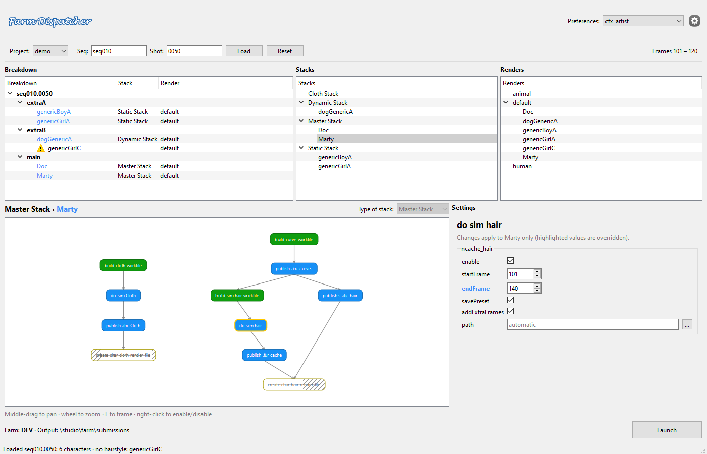

# Farm Dispatcher

A tool for CFX artists to send a whole shot's cloth, hair and render work to the
render farm in one click.



Demo video of the original version:

https://github.com/user-attachments/assets/f3217224-004d-4083-84ff-5f7298cbcf68

You load a shot and drag its characters into **stacks**. A stack is a pipeline
such as *build workfile → sim → cache → publish*. You can tweak any step for the
whole stack, or **override it for a single character**: say, sim Marty for 20
extra frames while everyone else uses the shot range. Hit **Launch** and the tool
writes one JSON submission for the farm.

> I first wrote this in 2017 as an in-house studio tool (Python 2, PySide 1).
> Version 2 is a modernisation: Python 3, PySide6/PySide2, a tested core, and the
> studio-specific code replaced by a pluggable backend so it runs anywhere.

## Features

- **Configurable pipelines.** Stacks, step types and per-artist defaults are JSON
  files, so you can add a step or a new pipeline without touching code.
- **Per-character overrides.** Overridden values are highlighted; right-click a
  label to reset it to the stack value.
- **Node graph** of the selected stack. Disable steps per stack or per character.
- **Render setups** with optional farm render settings.
- **Runs standalone or inside Maya** (PySide6 for Maya 2025+, PySide2 for 2022–2024).
- **Safe output.** Submissions and usage statistics are written atomically, and
  each user gets their own statistics file.

## Quick start

```bash
python -m pip install -e ".[standalone]"
```

```bash
python -m farm_dispatcher
```

Pick a preference, enter any sequence and shot (for example `seq010` / `0050`) and
press **Load**. The demo backend makes up a cast of six characters. Then:

1. Drag characters, an anim block or the whole shot from **Breakdown** onto a stack
   or render. Dropping on empty space creates a new one.
2. Click a stack to see its pipeline. Click a character inside it to edit
   overrides just for them.
3. Click a step in the graph to edit its settings.
4. Choose the farm in **Settings** (gear icon), then press **Launch**.

### Inside Maya

Put the repository folder on Maya's `PYTHONPATH`, then run:

```python
from farm_dispatcher.app import show_in_maya
show_in_maya()
```

## Configuration

The shipped configs live in [`farm_dispatcher/config`](farm_dispatcher/config):

| Folder         | What it holds |
|----------------|---------------|
| `preferences/` | The stacks and render setups an artist starts with |
| `stacks/`      | One pipeline each: its steps, their order (`output`), graph position and arrows |
| `nodes/`       | One step type each: group (`cloth`/`hair`/`render`), colour and default attributes |

Attribute types: `bool`, `int`, `float`, `string`, `list`, `path` and
`hair_component_list`. Point the tool at your own folders in **Settings**, or set
the `FARM_DISPATCHER_CONFIG` environment variable.

| Environment variable           | Default                               |
|--------------------------------|---------------------------------------|
| `FARM_DISPATCHER_CONFIG`       | the shipped `config` folder           |
| `FARM_DISPATCHER_PUBLISH_DIR`  | `~/farm_dispatcher/publish`           |
| `FARM_DISPATCHER_STATS_DIR`    | `~/.farm_dispatcher/statistics`       |
| `FARM_DISPATCHER_BACKEND`      | the built-in demo backend             |

## Connecting a studio pipeline

Everything that talked to the original studio's systems now goes through one
class. Subclass `farm_dispatcher.core.backend.Backend`:

```python
from farm_dispatcher.core.backend import Backend, CharacterInfo, ShotInfo

class StudioBackend(Backend):
    def projects(self): ...
    def load_shot(self, project, sequence, shot) -> ShotInfo: ...  # breakdown + frame range
    def job_name(self, job_type, fields) -> str: ...               # job_type: cloth / hair / render
    def output_path(self, fields) -> str: ...                      # used when a path is left empty
```

`fields` holds `project`, `sequence`, `shot` and, where relevant, `character`,
`description` and `output_type`. Then set
`FARM_DISPATCHER_BACKEND=my_studio.dispatch:StudioBackend`.

## Submission format

**Launch** writes one JSON file per launch:

```json
{
  "format_version": 2,
  "project": "demo", "sequence": "seq010", "shot": "0050", "frame_range": [101, 120],
  "queue": "dev",
  "characters": [
    {"alias": "Marty", "stack": "Master Stack", "hairstyle": "original",
     "jobs": {
       "cloth": {"name": "demo_seq010_0050_Marty_cloth", "steps": {"ncache_cloth": {"startFrame": 101, "...": "..."}}},
       "hair":  {"name": "demo_seq010_0050_Marty_hair",  "steps": {"...": "..."}}
     }}
  ],
  "render_scenes": [
    {"name": "demo_seq010_0050_render", "setup": "default", "characters": ["Doc", "Marty"],
     "depends_on": ["demo_seq010_0050_Marty_cloth", "..."], "settings": {}, "farm_render": {}}
  ]
}
```

A farm-side submitter reads this and creates the jobs, using `depends_on` to
order them.

## Project layout

```
farm_dispatcher/
  core/      Qt-free logic: config loading, pipelines, scene state, export, statistics
  ui/        PySide widgets: main window, tree models, node graph, property editor
  qt.py      PySide6 / PySide2 compatibility layer
  app.py     Standalone and Maya entry points
tests/       pytest suite (core logic, plus offscreen UI tests)
```

## Development

```bash
python -m pip install -e ".[dev]"
```

```bash
python -m pytest
```

The UI tests run offscreen and are skipped automatically if no Qt binding is installed.

## What changed from the 2017 version

- Ported to Python 3 and PySide6/PySide2. Drag and drop was redesigned, because
  packing Python objects into a `QDataStream` no longer works.
- Split a 1,100-line window class into a Qt-free core and small UI modules.
  Value parsing that was copied three times now lives in one property editor.
- Fixed bugs:
  - **Launch** failed on a fresh checkout because the output folder didn't exist.
  - Editing a path attribute could crash with a `NameError`.
  - A stack layout without an end step caused an `IndexError`.
  - Switching projects added the preferences to the list again each time.
  - The last launch message could never appear.
  - Stacks and renders created by dropping had no settings and broke the export.
  - Config files were matched by substring instead of exact name.
- The app no longer depends on the folder you launch it from.
- Statistics no longer get corrupted when two artists write at once.
- Settings are remembered between sessions. The farm now defaults to `DEV`
  instead of `PROD`.
- A new, self-describing submission format (see above) replaces the old one,
  which packed lists into `|`-separated strings.
- Everything specific to the original studio (show codes, file-type codes, job
  naming, render presets, internal API calls) was removed or made generic.

## License

MIT. See [LICENSE](LICENSE).
